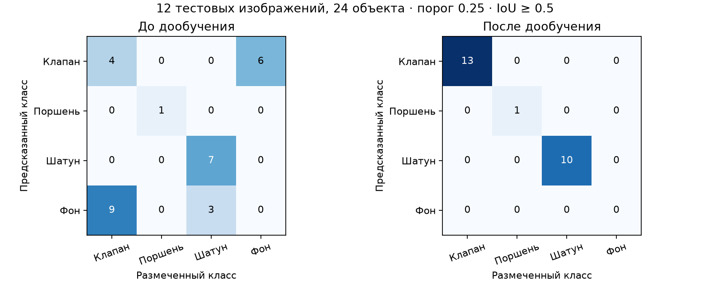

# Дообучение YOLO11n, версия 2

14 октября 2026 года модель дообучена ещё на 80 эпохах на CPU.
Исходные веса первой версии сохранены локально в
`models/checkpoints/conveyor-yolo11n-v1.pt`. Активные веса заменены на
`models/conveyor-yolo11n.pt` только после проверки кандидата.
Сервер после проверки не запускали, следующая команда
`./tools/run-panel.sh` загрузит новую модель.

## Датасет и разделение

Архив `models/kv-yolo.v2-v0.2.0.yolov11.zip` содержит 80 изображений:
прежние 50 и новые 30. Исходный ZIP и первая версия датасета сохранены.
У 20 новых/старых файлов совпадали короткие имена, а 12 групп исходников
в выгрузке Roboflow попали сразу в несколько выборок.

Группы восстановлены по обоим манифестам. Совпавшие имена разрешены
по содержимому изображений после уменьшения до 128×128: максимальное
среднее отличие от выбранного исходника 1.45 уровня RGB, минимальный
отрыв от другой группы 32.52 уровня. Правила и все 80 соответствий
сохранены в `config/dataset-source-groups-v2.json`, включая SHA-256 архива.
Сохранены прежние контрольные группы, использованные при обучении v1.
Варианты одного снимка остаются в одной выборке.

| Выборка | Изображения | Группы исходников | Клапаны | Поршни | Шатуны |
| --- | ---: | ---: | ---: | ---: | ---: |
| train | 56 | 11 | 75 | 33 | 44 |
| valid | 12 | 6 | 4 | 1 | 7 |
| test | 12 | 6 | 13 | 1 | 10 |

Проверены 80 разных декодированных изображений и 188 объектов.
187 полигонов преобразованы в охватывающие рамки, одна исходная рамка
сохранена. Координаты нормализованы, классы остались Pin/Piston/Shatun.
В панели и на видео им соответствуют Клапан/Поршень/Шатун.
Новые фото добавляют клапаны и шатуны, прежние примеры поршней сохраняют
третий класс. В тесте один пример поршня, это ограничение проверки.

## Обучение

Загружены обученные веса v1, перенесены все совместимые веса.
Выполнен новый цикл fine-tuning с `resume=False`, оптимизатор
и расписание созданы заново. Это дообучение прежних весов на расширенном
наборе. Параметры: `config/yolo11n-finetune-v2.yaml`, AdamW, `lr0=0.0003`,
512 px, batch 8, 6 потоков CPU, 80 эпох без раннего завершения.
PyTorch 2.14.1+cpu, Ultralytics 8.4.177, CUDA не скомпилирована.
Обучение заняло около 7 минут 42 секунд.

| Выборка | Модель | Precision | Recall | mAP50 | mAP50–95 |
| --- | --- | ---: | ---: | ---: | ---: |
| valid | v1 | 93.7% | 47.6% | 68.4% | 55.7% |
| valid | v2 | 93.9% | 100% | 99.5% | 80.4% |
| test | v1 | 84.3% | 64.6% | 86.4% | 56.8% |
| test | v2 | 95.2% | 100% | 99.5% | 75.4% |

Precision и Recall в этой таблице вычислены валидатором Ultralytics
при его выбранной точке F1. Это не обязательно порог интерфейса 0.25.
Сравнение на рабочем пороге проведено отдельно ниже.

## Проверка на пороге панели

`tools/compare_detectors.py` сравнил обе модели при `conf=0.25`,
512 px на тех же кадрах. Соответствие объекта рамке проверяется
по IoU ≥ 0.5 без предварительного совпадения класса, чтобы подмена
клапана шатуном учитывалась как ошибка класса.

| Проверка test, 12 кадров / 24 объекта | v1 | v2 |
| --- | ---: | ---: |
| Кадры с точным количеством всех классов | 3 из 12 | 12 из 12 |
| Пропущенные объекты по IoU | 12 | 0 |
| Лишние детекции по IoU | 6 | 0 |
| Подмена клапан ↔ шатун среди совпавших рамок | 0 | 0 |

У v2 правильно обнаружены 13 клапанов, один поршень, 10 шатунов.
У прежней модели были прежде всего пропуски и лишние рамки; прямой
подмены классов на данном контрольном наборе не зарегистрировано.
На valid количество совпало во всех 12 кадрах, но на одном кадре
локализация рамки не прошла IoU 0.5: один геометрический пропуск и одна
лишняя рамка при правильном классе. Это не скрыто в отчёте сравнения.



Дополнительно настоящая YOLO и ByteTrack прошли шесть искусственных
сценариев движения через линию, паузы и продолжения на контрольных фото:
старые три класса, новый шатун спереди, новый шатун сбоку, новый клапан.
Итог Клапан 2, Поршень 1, Шатун 3, всего 6. Каждый сценарий добавил
ровно одну деталь, пауза не дала повторного учёта.
Это движение изображений программой, не физический прогон ленты.

## Файлы и повтор запуска

Отчёты: `reports/dataset-audit-v2.json`,
`reports/yolo11n-v2-evaluation.json`, `reports/yolo11n-v2-comparison.json`,
`reports/yolo11n-v2-metrics-comparison.json`,
`reports/yolo11n-v2-tracking-check.json`, история 80 эпох и графики.

SHA-256 активных весов:
`d37349daec7c0e99dbd0675bdafd2cc668f58798cae60054623dc0e56a210a1d`.

Команды подготовки и обучения для чистых новых выходных каталогов:

```bash
.venv/bin/python tools/prepare_training_dataset.py \
  --archive models/kv-yolo.v2-v0.2.0.yolov11.zip \
  --raw models/annotated-source-v2 --output models/training-dataset-v2 \
  --groups-config config/dataset-source-groups-v2.json --expected-count 80 \
  --audit-report reports/dataset-audit-v2.json

.venv/bin/python tools/train_yolo.py \
  --data models/training-dataset-v2/data.yaml \
  --config config/yolo11n-finetune-v2.yaml \
  --weights models/checkpoints/conveyor-yolo11n-v1.pt \
  --name yolo11n-v2-finetune-80epochs --no-deploy --report-prefix yolo11n-v2

.venv/bin/python tools/compare_detectors.py \
  --baseline models/checkpoints/conveyor-yolo11n-v1.pt \
  --candidate models/runs/yolo11n-v2-finetune-80epochs/weights/best.pt \
  --dataset models/training-dataset-v2 \
  --output reports/yolo11n-v2-comparison.json
```

Скрипты откажутся перезаписывать готовый набор и завершённый запуск.
При повторном эксперименте нужны другие каталоги и `--name`.
Checkpoint v1 при необходимости можно получить из прежнего Git-коммита
`e7e8c96`, файл `models/conveyor-yolo11n.pt`.

## Регламент после дообучения

Все 25 проверок на 100 баллов повторно сверены в
[чеклисте](competition-checklist.md). Улучшение детектора относится
к точному подсчёту трёх типов, но 15 баллов за количество и 5 за Stop/Start
подтверждает реальный прогон судьи. Нужна серия по десять деталей каждого
типа в случайном порядке, с паузой, итогом 10/10/10 и автоматическим
отчётом 30. Размечать или исправлять счётчики вручную в ходе зачёта нельзя.

Программные проверки: 42 Python-теста, 5 JavaScript-тестов, нативные
проверки управления и прошивки. Крепление даёт отдельные 15 баллов,
печать 20; готовность файлов и измеренных размеров пока не подтверждена.
Сервер оставлен выключенным по просьбе команды. Следующий запуск
`./tools/run-panel.sh` использует веса v2 и CPU.
